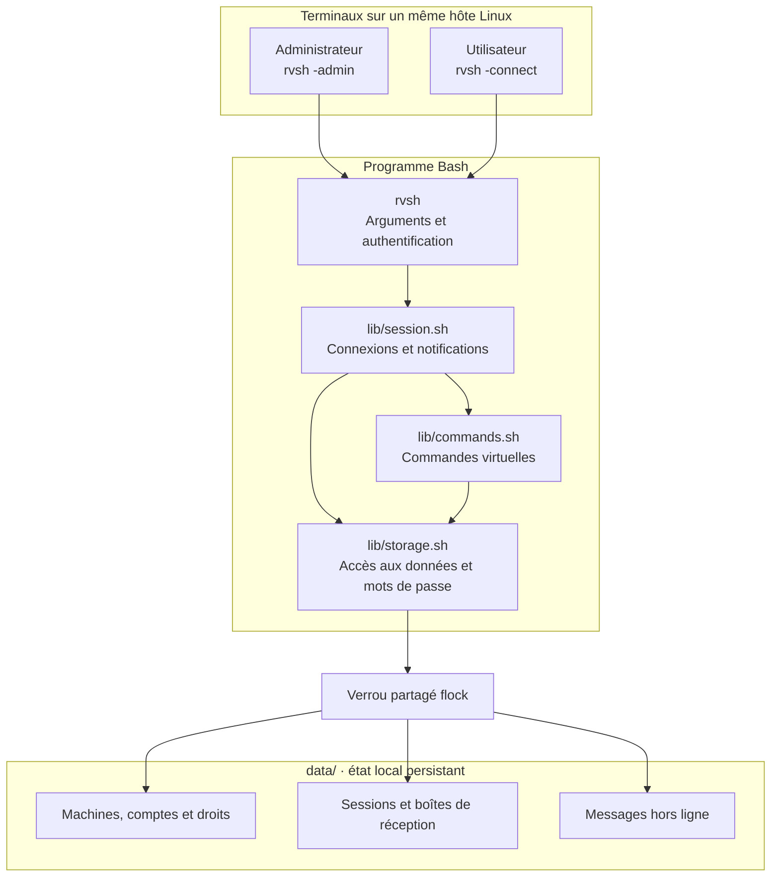
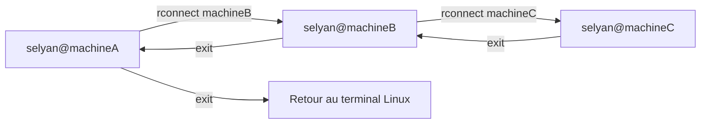
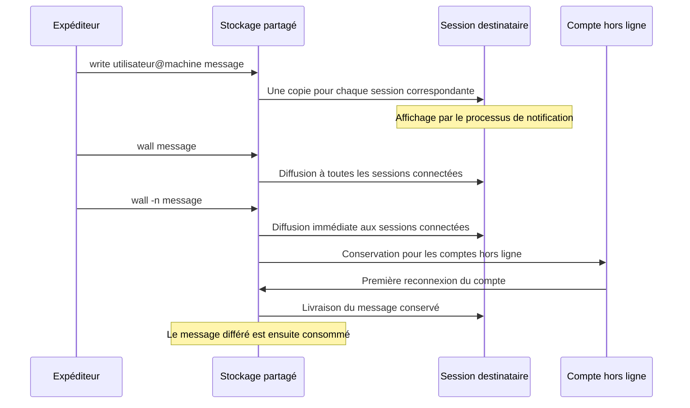

<div align="center">

# `rvsh`

**Un réseau virtuel de machines, piloté depuis un shell Bash.**

LO14 · UTT · 2026–2027 · Jules & Selyan

[Prise en main](#prise-en-main) · [Architecture](#architecture) · [Commandes](#commandes) · [Tests](#tests) · [Sujet](docs/LO14-Projet-2026-2027.pdf)

</div>

---

`rvsh` permet de créer des machines et des utilisateurs virtuels, d'attribuer des
accès, de naviguer entre les machines et d'échanger des messages depuis plusieurs
terminaux. Les données sont partagées dans un dossier local et persistent entre
les lancements.

> [!IMPORTANT]
> Le sujet **2026–2027** est développé sur **`codex/rvsh-2026-2027`**.
> `main` contient encore l'ancien serveur d'archives en C. Pour récupérer la bonne
> version, utiliser les commandes de la prise en main ci-dessous.

## En bref

| Je veux… | Je fais | Ce qui se passe |
|---|---|---|
| Administrer le réseau | `./rvsh -admin` | Authentification de root sur `hostroot`. |
| Me connecter | `./rvsh -connect machineA selyan` | Vérification du compte, des droits et du mot de passe. |
| Créer une machine | `host add machineA` | Ajout d'une machine virtuelle au réseau. |
| Donner un accès | `user grant selyan machineA` | Le compte peut se connecter à cette machine. |
| Changer de machine | `rconnect machineB` | Ouverture d'une connexion imbriquée. |
| Revenir en arrière | `exit` | Retour à la machine précédente, ou fermeture de la dernière connexion. |
| Voir qui est connecté | `who` / `rusers` | Sessions sur la machine courante / tout le réseau. |
| Envoyer un message | `write selyan@machineA Bonjour !` | Livraison aux sessions correspondantes. |
| Prévenir aussi les absents | `wall -n Réunion demain` | Diffusion immédiate et livraison différée aux comptes hors ligne. |

Les commandes `host`, `user` et `wall` nécessitent une session administrateur.
Les commandes sans `./rvsh` se saisissent **dans le shell virtuel**.

## Prise en main

### 1. Récupérer le bon projet

```bash
git clone --branch codex/rvsh-2026-2027 \
  https://github.com/JulesVRD/Shell_client-server_Project.git
cd Shell_client-server_Project
```

Depuis un clone déjà présent, avec les modifications locales sauvegardées :

```bash
git fetch origin
git switch codex/rvsh-2026-2027
```

**Environnement :** Linux ou WSL, Bash ≥ 3.2, OpenSSL avec `passwd -6`,
`flock` fourni par util-linux, et les outils usuels `grep`, `awk`, `tr`, `date`,
`sleep`, `mkdir`, `mv` et `rm`. `make`, Python 3 et ShellCheck servent aux tests.
Sur macOS, suivre la [méthode Docker](#docker).

### 2. Initialiser le réseau — terminal 1

```bash
./rvsh -admin
```

Au premier lancement, choisir et confirmer le mot de passe de l'administrateur.
Les lancements suivants demandent ce mot de passe. Le prompt est alors :

```text
root@hostroot >
```

Saisir les commandes suivantes **une par une** ; `user add` demande un mot de
passe et sa confirmation avant de rendre le prompt.

```text
host add machineA
host add machineB
host add machineC
user add selyan
user grant selyan machineA
user grant selyan machineB
user grant selyan machineC
afinger selyan Membre du binôme LO14
```

### 3. Ouvrir une session — terminal 2

Dans la **même copie du projet, sur le même hôte** :

```bash
./rvsh -connect machineA selyan
```

Après saisie du mot de passe défini pour ce compte :

```text
selyan@machineA >
```

Essayer `who`, `rusers`, `finger` puis `help`. Depuis le terminal administrateur,
`write selyan@machineA Bonjour depuis hostroot` permet de vérifier la messagerie.

### 4. Naviguer puis revenir

Depuis la session sur machineA :

```text
rconnect machineB
rconnect machineC
exit
exit
exit
```

Les deux premiers `exit` reviennent respectivement sur machineB puis machineA.
Le dernier ferme la session.

## Architecture

Les « machines » sont des entités simulées. Tous les terminaux d'un même réseau
utilisent les mêmes fichiers locaux ; aucune machine virtuelle système n'est lancée.



Les accès partagés sont encadrés par `flock`. La saisie des mots de passe a lieu
hors du verrou pour ne pas bloquer les autres terminaux pendant une interaction.

| Fichier | Responsabilité |
|---|---|
| [`rvsh`](rvsh) | Analyse des arguments, modes `-admin` et `-connect`, authentification initiale. |
| [`lib/storage.sh`](lib/storage.sh) | Stockage, verrouillage, mots de passe, droits et détection des sessions orphelines. |
| [`lib/session.sh`](lib/session.sh) | Pile de connexions, identité courante, notifications et nettoyage. |
| [`lib/commands.sh`](lib/commands.sh) | Aiguillage et implémentation des commandes du shell virtuel. |
| [`tests/`](tests/) | Contrat CLI et scénarios fonctionnels avec plusieurs pseudo-terminaux. |

## Cycle d'une session



- Chaque `rconnect` vérifie le droit d'accès à la machine cible et conserve la connexion précédente.
- A et B restent enregistrées comme connectées pendant que C est au premier plan.
- `su utilisateur` remplace l'identité de la connexion courante sans changer de machine.
- Deux connexions du même utilisateur sur la même machine sont deux sessions distinctes.
- Une sortie normale, EOF, SIGINT, SIGHUP ou SIGTERM nettoie les sessions du processus.

## Parcours d'un message



`write` refuse un destinataire non connecté sur la machine indiquée. Les notifications
sont vérifiées environ toutes les **0,2 seconde**, même pendant l'attente d'une
commande. Un message différé de `wall -n` est consommé à la première reconnexion
du compte et n'est pas répété aux connexions suivantes.

<a id="commandes"></a>
## Commandes

### Utilisateurs et administrateur

| Commande | Rôle |
|---|---|
| `who` | Sessions de la machine courante, avec utilisateur, machine, date et heure. |
| `rusers` | Même information pour toutes les machines du réseau. |
| `rhost` | Liste des machines virtuelles. |
| `rconnect machine` | Connexion imbriquée à une autre machine, avec le compte courant. |
| `su utilisateur` | Changement d'utilisateur après authentification, sur la même machine. |
| `passwd` | Vérification du mot de passe actuel et changement valable sur tout le réseau. |
| `finger [utilisateur]` | Informations complémentaires ; compte courant si aucun nom n'est donné. |
| `write utilisateur@machine message` | Message à toutes les sessions du compte sur la machine désignée. |
| `exit` | Ferme la connexion courante et revient à la précédente, si elle existe. |
| `help` | Aide du shell virtuel. |

### Administration

Ces commandes nécessitent **l'identité root dans une session ouverte par `-admin`**.

| Commande | Rôle |
|---|---|
| `host add machine` · `host del machine` · `host list` | Ajout, suppression et liste des machines. |
| `user add utilisateur` · `user del utilisateur` · `user list` | Ajout, suppression et liste des comptes et droits. |
| `user grant utilisateur machine` | Attribution d'un droit d'accès. |
| `user revoke utilisateur machine` | Retrait d'un droit d'accès. |
| `user passwd utilisateur` | Redéfinition du mot de passe d'un compte ordinaire. |
| `afinger utilisateur informations` | Modification des informations complémentaires. |
| `wall message` | Diffusion à toutes les sessions connectées. |
| `wall -n message` | Diffusion aux connectés et conservation pour les comptes hors ligne. |

Les noms commencent par une lettre et acceptent **32 caractères maximum** parmi
les lettres ASCII, chiffres, `_` et `-`. Les messages et informations peuvent
contenir des espaces. Les guillemets, expansions, pipelines et redirections ne
sont pas interprétés comme dans un shell Linux.

## Données et règles de fonctionnement

```text
data/                         # État local, ignoré par Git
├── .rvsh-data                 # Marqueur du dossier de données
├── initialized                # Initialisation terminée
├── lock                       # Verrou partagé
├── hosts/<machine>/           # Machines virtuelles
├── users/<utilisateur>/
│   ├── password               # Hachage salé du mot de passe
│   ├── grants                 # Machines autorisées
│   └── info                   # Informations de finger
├── sessions/<pid-numéro>      # Identité, machine, date/heure et PID
├── inbox/<pid-numéro>         # Messages des sessions connectées
└── mail/<utilisateur>         # Messages différés
```

Le dossier est privé (**700**) et les fichiers créés sont privés (**600**).
Les mots de passe sont saisis sans affichage et enregistrés sous forme de
hachages **SHA-512 crypt avec un sel aléatoire**, calculés par OpenSSL.

Pour conserver un réseau ailleurs, utiliser un dossier vide ou un dossier déjà
initialisé par rvsh, et fournir la même valeur dans chaque terminal :

```bash
RVSH_DATA_DIR=/chemin/vers/mon-reseau ./rvsh -admin
RVSH_DATA_DIR=/chemin/vers/mon-reseau ./rvsh -connect machineA selyan
```

Règles retenues pour cette version :

- `hostroot` et le compte root ne peuvent pas être supprimés.
- La suppression d'une machine ou d'un compte utilisé, et le retrait d'un droit utilisé, sont refusés.
- Un compte ordinaire ouvre le mode admin par `rvsh -admin` ; `su root` n'est pas une porte d'entrée vers ce mode.
- Une session admin passée à un compte ordinaire perd ses commandes admin jusqu'au retour authentifié à root.
- Un dossier existant non vide, sans marqueur rvsh, est refusé pour protéger ses fichiers.
- La saisie n'est jamais exécutée par `eval` ou transmise à un shell système.

## Tests

| Contrôle | Résultat de la validation du code `5024581` |
|---|---|
| Syntaxe Bash | Vérifiée sur le lanceur, les modules et le test CLI. |
| Interface de lancement | **11 vérifications réussies.** |
| Intégration sous Linux | **7 scénarios réussis**, dont plusieurs terminaux simultanés. |
| ShellCheck | Aucun diagnostic avec analyse des modules sourcés. |

Les scénarios couvrent l'authentification, les droits, A → B → C et les retours,
`su`, le changement global de mot de passe, les sessions multiples, les messages
immédiats et différés, les modifications concurrentes et le nettoyage des sessions.

```bash
make test    # Syntaxe, CLI et intégration ; nécessite Python 3
make lint    # Analyse statique ; nécessite ShellCheck
```

Les tests utilisent des comptes et dossiers temporaires, indépendants des données
du projet. Les preuves et les limites sont conservées dans le [rapport](RAPPORT-CODEX.md).

## Docker

### Exécuter les tests sous Linux

Depuis la racine du dépôt, avec Docker lancé :

```bash
docker build -t rvsh-tests:local -f tests/Dockerfile .
docker run --rm --network none --read-only --tmpfs /tmp:rw,nosuid,nodev \
  -v "$PWD:/project:ro" -w /project rvsh-tests:local make test
```

L'image fournit Bash, OpenSSL, util-linux, make et Python. Le code est monté en
lecture seule ; le conteneur de test n'a pas de réseau.

### Essayer avec deux terminaux

Démarrer **un seul conteneur partagé** pour conserver le même espace de processus :

```bash
docker run --rm -d --name rvsh-demo --network none --read-only \
  --tmpfs /tmp:rw,nosuid,nodev -v "$PWD:/project:ro" \
  -v rvsh-demo-data:/rvsh-data -e RVSH_DATA_DIR=/rvsh-data \
  rvsh-tests:local sleep infinity
```

| Terminal | Commande à lancer |
|---|---|
| 1 — administration | `docker exec -it rvsh-demo ./rvsh -admin` |
| 2 — utilisateur, après création du compte et des droits | `docker exec -it rvsh-demo ./rvsh -connect machineA selyan` |

Suivre ensuite les étapes de la prise en main. Les données persistent dans le
volume Docker local `rvsh-demo-data`. Après avoir quitté les sessions :

```bash
docker stop rvsh-demo
```

## Limites connues

- La simulation fonctionne sur **un même hôte** avec un stockage partagé. Elle ne crée ni compte Linux ni réseau TCP entre ordinateurs.
- L'identification des processus repose sur les PID locaux. Une réutilisation de PID ou un redémarrage peut nécessiter de vérifier les sessions résiduelles.
- Après SIGKILL, les sessions dont le processus est mort sont retirées lors d'une consultation ou d'un envoi ; il n'y a pas de nettoyage instantané garanti.
- Une notification peut couper visuellement le prompt pendant la saisie.
- La validation automatisée reste à compléter par une démonstration manuelle à deux sur votre Linux/WSL.

## Documentation et calendrier

| Document | Contenu |
|---|---|
| [Sujet officiel](docs/LO14-Projet-2026-2027.pdf) | Énoncé LO14 2026–2027. |
| [Cahier des charges](docs/CAHIER-DES-CHARGES.md) | Exigences et choix de comportement. |
| [Guide de reprise](docs/REPRISE.md) | Historique, branches et récupération du projet. |
| [Rapport Codex](RAPPORT-CODEX.md) | Travail réalisé, commandes de validation et limites. |

| Échéance du sujet | Livrable |
|---|---|
| Avant le **4 décembre 2026** | Rapport intermédiaire : structure et choix envisagés. |
| Première semaine de **janvier 2027**, créneau à confirmer | Présentation et test d'environ 20 minutes. |
| Avant le **10 janvier 2027** | Rapport final. |

<details>
<summary><strong>Pourquoi le dépôt contient-il aussi un ancien projet ?</strong></summary>

Le dépôt a été commencé sur le sujet 2025–2026 : un serveur d'archives `vsh` en C.
Le bon sujet demande `rvsh` en Bash. Le travail précédent et son attribution ont
été conservés dans l'historique, au commit
[`2a93ae5`](https://github.com/JulesVRD/Shell_client-server_Project/commit/2a93ae5616736f44fddcdc6c077420f8f71e81a0),
et dans une branche d'archive locale `archive/vsh-2025-2026`.

La nouvelle implémentation se trouve sur `codex/rvsh-2026-2027`. Sa publication
ne modifie pas `main` ; sa fusion devra être relue par le binôme.

</details>
